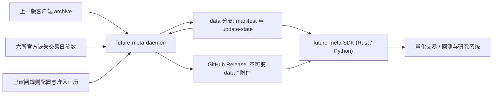

# future-meta

[](https://crates.io/crates/future-meta)
[](https://pypi.org/project/future-meta/)
[](https://github.com/zynthium/future-meta/actions/workflows/ci.yml)
[](https://github.com/zynthium/future-meta/actions/workflows/update-fee-data.yml)
[](https://www.rust-lang.org/)
[](https://www.python.org/)
[](https://raw.githubusercontent.com/zynthium/future-meta/data/manifest.json)
[](LICENSE)

中国六大期货交易所（SHFE / INE / DCE / CZCE / CFFEX / GFEX）历史手续费、保证金与合约规格的高性能本地 as-of 查询 SDK（支持 **Rust** 与 **Python**）。

`future-meta` 从六所官方结算参数与规则原件维护具体期货合约的手续费、买卖保证金率和合约规格（合约乘数、最小变动价位）变更历史。客户端通过独立 `data` 分支的固定索引拉取经过 SHA-256 校验的不可变压缩数据包（Schema 4），在本地内存中完成零网络依赖、纳秒级热路径的时点（as-of）查询。

> [!IMPORTANT]
> **SDK 与数据解耦发布**：每日数据更新独立发布为 `data-*` Release 附件并更新 [manifest.json](https://raw.githubusercontent.com/zynthium/future-meta/data/manifest.json)，客户端无需因日常数据更新而升级 SDK（包含大商所 `F` 月均价合约的数据包需 SDK `v0.7.0+`）。六所日度参数最新尝试、成功时间与完整核验截止交易日（`checked_through`）请以 [update-state.json](https://raw.githubusercontent.com/zynthium/future-meta/data/update-state.json) 为准，不以 archive 生成时间代替核验进度。

---

## 核心特性

- **具体合约粒度与 TqSdk 编码规范**：手续费与规格严格绑定具体期货合约（如 `SHFE.cu2701`、`CZCE.SR701`）；主连/指数符号（`KQ.m@...`、`KQ.i@...`）不返回手续费或规格。
- **支持大商所月均价合约**：完整支持 `DCE.l2611F`、`DCE.pp2611F`、`DCE.v2611F` 等月均价合约，保留大写 `F` 尾缀及独立费率、规格和生命周期；品种查询（`DCE.l`、`DCE.pp`、`DCE.v`）同时覆盖普通与月均价合约。
- **历史规格与手续费时点（As-Of）查询**：支持按 RFC3339 时间戳或交易日查询任意历史截面的开仓、平昨、平今、日内开仓费率、买卖保证金率，以及合约乘数（`lot_size`）、最小变动价位（`tick_size`）和派生的每手每跳价值（`tick_value`）。
- **高频回测跨日游标热路径**：提供预解析 `ContractHandle`、`PreparedFee` 与跨日 `PreparedFeeCursors` 游标表；热路径仅需一次 `i64` 纳秒时间戳比较与连续槽位读取，零字符串解析、零哈希查找、零堆内存分配。
- **严格官方证据与零伪造边界**：仅接受六所官方参数与规则；严格区分零费率（`0`）与未知（`Unknown` / `None`），缺失数据、日期不符或反爬异常直接报错阻断，绝不以旧值、邻近合约或品种默认值冒充。
- **Rust 与 Python 双语言原生支持**：核心库 `future-meta` 保持 100% 纯安全 Rust（`#![forbid(unsafe_code)]`）；Python 包 `future_meta` 基于 `PyO3 + maturin`（`abi3-py310`）构建原生扩展，内置完整 PEP 561 类型注解（`.pyi`）。

---

## 安装

### Rust

通过 [crates.io](https://crates.io/crates/future-meta) 安装：

```bash
cargo add future-meta --features download
```

或在 `Cargo.toml` 中添加：

```toml
[dependencies]
future-meta = { version = "0.9", features = ["download"] }
tokio = { version = "1", features = ["macros", "rt-multi-thread"] }
time = "0.3"
```

> 若仅需加载本地离线 `.fmeta.zst` 文件而无需在线下载，可省略 `features = ["download"]`。

### Python

通过 [PyPI](https://pypi.org/project/future-meta/) 安装预编译 Wheel（支持 Linux `x86_64`/`aarch64`、macOS `x86_64`/`arm64`、Windows `x86_64`，Python 3.10+）：

```bash
pip install future-meta
```

如需在源码仓库本地编译安装：

```bash
maturin develop --release
```

---

## 快速开始

### Rust 示例

```rust
use future_meta::{DownloadConfig, load_or_fetch};

#[tokio::main]
async fn main() -> Result<(), Box<dyn std::error::Error>> {
    // 自动拉取最新 manifest 与数据包并缓存到本地
    let meta = load_or_fetch(DownloadConfig::default()).await?;

    // 1. 查询合约静态规格与每跳价值
    let contract = meta.contract("SHFE.cu2701")?;
    println!(
        "lot_size={}, tick_size={}, tick_value={}",
        contract.lot_size,
        contract.tick_size,
        contract.tick_value()
    );

    // 2. 查询历史时点有效的合约规格
    let historical_spec = meta.contract_spec_asof(
        "DCE.p2605",
        "2026-04-09T10:00:00+08:00",
    )?;
    println!("historical tick_size={}", historical_spec.tick_size);

    // 3. 查询历史时点所属交易日的手续费与保证金率
    let fee = meta.contract_fee_asof("SHFE.cu2701", "2026-10-30T10:00:00+08:00")?;
    println!("open={:?}, close_today={:?}", fee.open_fee, fee.close_today_fee);

    Ok(())
}
```

也可以直接运行内置在线示例验证：

```bash
cargo run -p future-meta --features download --example online_smoke \
  SHFE.cu2701 2026-10-30T10:00:00+08:00
```

#### 长驻进程条件刷新（`DownloadClient`）

长驻交易或研究服务需要定期检查数据更新时，推荐持有 `DownloadClient` 实例以复用连接池、内存 ETag 和已加载的 `FutureMeta`：

```rust
use future_meta::{DownloadClient, DownloadConfig};

let mut client = DownloadClient::load(DownloadConfig::default()).await?;
let mut handle = client.meta().resolve_contract("SHFE.cu2701")?;

// 在定时任务或盘前检查时调用（请勿放入逐笔行情热路径）
if client.refresh().await? {
    // 返回 true 表示已加载新 archive，需重新解析句柄和构建预计算游标表
    handle = client.meta().resolve_contract("SHFE.cu2701")?;
}
let contract = client.meta().contract_for_handle(handle)?;
```

- `refresh()` 在 HTTP `304 Not Modified` 或 archive SHA-256 未变时返回 `Ok(false)`，零解压、零磁盘读取；
- 当远端发布新数据包时自动下载、校验 SHA-256 并原子替换内存快照后返回 `Ok(true)`；
- 网络异常时返回 `Err`，并完整保留当前内存实例与本地磁盘缓存。

### Python 示例

Python 端提供同步接口（内部托管 Tokio Runtime 并在网络 I/O 与解压期间释放 GIL）：

```python
import future_meta

# 1. 在线加载（或使用 future_meta.load_or_fetch() / future_meta.FutureMeta.from_file(...)）
client = future_meta.DownloadClient.load()
meta = client.meta()

# 2. 查询合约规格与历史时点手续费
contract = meta.contract("SHFE.cu2701")
print(contract.lot_size, contract.tick_size, contract.tick_value())

spec = meta.contract_spec_asof("DCE.p2605", "2026-04-09T10:00:00+08:00")
fee = meta.contract_fee_asof("SHFE.cu2701", "2026-10-30T10:00:00+08:00")
print(spec.tick_size, fee.open_fee.to_dict(), fee.close_today_fee.to_dict())

# 3. 高频回测跨日游标表
handle = meta.resolve_contract("SHFE.cu2701")
cursors = meta.prepare_fee_cursors([handle], "2026-10-30", 1793325600_000_000_000)
prepared = cursors.advance_and_get("2026-10-30", 0, 1793325600_000_000_000)
print("open 2 lots @ 75000:", prepared.open_amount(75000.0, 2))

# 4. 定期检查远端是否有新数据包
if client.refresh():
    meta = client.meta()
```

---

## 高频回测热路径

跨多日 Tick 回测推荐预先将合约 symbol 解析为 `ContractHandle` 并映射为连续整数槽位（`slot`），通过 `prepare_fee_cursors` 构建跨日游标表：

```rust
use future_meta::{DownloadConfig, load_or_fetch};

#[tokio::main]
async fn main() -> Result<(), Box<dyn std::error::Error>> {
    let meta = load_or_fetch(DownloadConfig::default()).await?;
    let handle = meta.resolve_contract("SHFE.cu2701")?;
    let mut fees = meta.prepare_fee_cursors(
        [handle],
        first_tick.trading_date,
        first_tick.unix_nanos,
    )?;

    for tick in ticks {
        if tick.unix_nanos >= fees.next_change_unix_nanos() {
            fees.advance_to(tick.trading_date, tick.unix_nanos)?;
        }

        let fee = fees.current(tick.fee_slot)?;
        let amount = fee.open_amount(tick.price, tick.lots);
        println!("open fee amount={amount}");
    }

    Ok(())
}
```

也可直接调用 `fees.advance_and_get(tick.trading_date, tick.fee_slot, tick.unix_nanos)?` 合并推进与读取。`PreparedFeeCursors` 仅在跨越生效边界的慢路径重建槽位；常规 Tick 路径仅包含一次 `i64` 比较与一次下标读取。

---

## 查询 API 速查

完整数据结构与用法详见 [客户端查询 API 说明](docs/client-api.md)。

| API | 说明 |
| --- | --- |
| `contract(symbol)` | O(1) 查询合约乘数、最小变动价位与生命周期等规格元数据 |
| `contract_for_handle(handle)` | 使用预解析 `ContractHandle` 查询合约规格；`tick_value()` 返回每手每跳价值 |
| `contract_spec_asof(symbol, at)` | 查询 RFC3339 时间点有效的合约乘数、最小变动价位和每手每跳价值 |
| `contract_spec_at / on(...)` | 使用预解析时间或交易日查询历史合约规格 |
| `contract_spec_for_handle_at / on(...)` | 使用 `ContractHandle` 查询历史合约规格，避免重复解析 symbol |
| `contract_fee_asof(symbol, at)` | 查询具体期货合约在某个 RFC3339 时间点所属交易所本地日期的手续费 |
| `contract_fee_at / on(symbol, ...)` | 使用预解析时间戳或交易所本地交易日查询日级手续费 |
| `resolve_contract(symbol)` | 将合约 symbol 预解析为轻量句柄 `ContractHandle` |
| `prepare_fee_cursors(handles, trading_date, start_unix_nanos)` | 构建跨日 day-fixed 游标表（高频 Tick 回测推荐入口） |
| `for_trading_day(trading_date)` | 构建单交易日快照 `TradingDayMeta`，支持 `prepare_fee` 与 `prepare_fee_book` |
| `underlying_fees_asof(underlying_symbol, at)` | 查询某品种在该时间点非 `NotTrading` 的全部具体合约手续费（保留 `Unknown`） |

### 手续费与保证金字段语义

- `open_fee`：开仓手续费（`FixedPerLot` 按手固定金额 / `Rate` 按成交额比例）
- `close_yesterday_fee`：平昨手续费
- `close_today_fee`：平今手续费
- `intraday_open_fee`：日内开仓手续费（未知时为 `None`）
- `buy_margin_rate` / `sell_margin_rate`：买/卖交易保证金率
- `valid_from` / `valid_to`：生效闭区间起点与开区间终点（`valid_to = None` 表示当前仍有效）

> [!NOTE]
> 手续费按交易所本地交易日生效，不在盘中切换；时间戳查询会先映射到交易所本地日期。客户端 archive 仅存储不可派生的基础字段，不写入源站展示价格、每手保证金金额或每跳盈亏等派生值。

---

## 架构与数据更新机制



### 工作区结构

| 路径 | 说明 |
| --- | --- |
| `crates/future-meta` | 纯 Rust 客户端核心库：公开模型、Schema 4 archive 编解码、TqSdk symbol 解析、as-of 查询及可选 `download` 缓存 |
| `crates/future-meta-py` | 基于 `PyO3 + maturin`（`abi3-py310`）的独立 Python 扩展绑定 `future_meta`，保持核心 Rust 库零 Python 依赖 |
| `crates/future-meta-daemon` | 维护端增量合并、六所批次完整性校验，以及本地 SQLite 重建、证据审阅与导出工具 |
| `config/` | 经审阅的官方轻量规则配置（`official-rules.json`）与交易日历准入配置（`update-calendar.json`） |
| `scripts/` | 生产自动更新、跨 runner 故障转移采集、无认证公开合约规格发现与独立手动规则审阅工具 |

### 自动更新与时间语义

- **默认索引地址**：`https://raw.githubusercontent.com/zynthium/future-meta/data/manifest.json`（可通过环境变量 `FUTURE_META_CACHE_DIR` 覆盖本地缓存目录）。
- **无 SQLite 在线增量**：GitHub Actions（`.github/workflows/update-fee-data.yml`）在法定交易日准入窗口内直接以既有客户端 archive 为基线补齐缺失交易日；仅当业务字段发生变化时发布新的 `data-*` Release 附件，无业务变化时保持 archive 字节与 SHA-256 不变，仅推进状态检查点。
- **时间字段区分**：
  - `manifest.generated_at` / `data_version`：当前数据包生成时间；
  - `manifest.history_end`：数据包中最后一条已批准费率记录的起始时间（**不是**核验截止日）；
  - `update-state.json` 中的 `checked_through` 与 `last_success_at`：六所日度参数完整核验到的交易日与最近成功检查时间。

---

## 文档导航

| 文档 | 内容说明 |
| --- | --- |
| [客户端查询 API 说明](docs/client-api.md) | Rust 与 Python 客户端完整 API、返回模型与使用示例 |
| [Archive 格式说明](docs/archive-format.md) | Schema 4 压缩格式、共享字典与增量编码规范 |
| [自动更新与部署说明](docs/deployment.md) | 定时采集准入窗口、`update-state.json` 字段语义、跨 runner 接续与故障排查 |
| [版本与发布规则](docs/releasing.md) | 提交、CI 验证、SDK 版本升级判定与 crates.io / PyPI / GitHub Release 发布流程 |
| [官方数据重建说明](docs/official-rebuild.md) | 本地从零重建 SQLite 维护库与历史参数导入说明 |
| [官方历史证据流程](docs/official-evidence.md) | 本地历史公告/参数原件暂存、SHA-256 复核与证据配对规范 |
| [维护脚本说明](scripts/README.md) | 采集、规则审阅与辅助脚本命令行说明 |

---

## 开发与验证

常用本地检查命令：

```bash
python3 scripts/check_docs.py
cargo fmt --all -- --check
cargo check --workspace --all-targets
cargo test --workspace
cargo test -p future-meta --features download
cargo clippy --workspace --all-targets --all-features -- -D warnings
cargo build -p future-meta-py
python3 -m unittest discover -s tests
```

性能基准 smoke test：

```bash
cargo run --release -p future-meta --example perf_smoke -- public/latest.fmeta.zst 1000000 100
```

---

## 常见问题

**为什么客户端只下载不可变 archive 附件，而不直接请求交易所？**

交易所官方页面存在时段限制、反爬策略及历史格式差异。维护端集中完成多源采集、完整性核验与规则对齐后生成带 SHA-256 校验的快照，客户端即可在本地获得可复现、确定性的回测与交易查询输入。

**新上市合约缺少参数或规格元数据时会怎样？**

日更会严格报错并阻断推进 `checked_through`，绝不从旧合约、邻近月份或品种默认值猜测补齐。对于公开合约文本可无认证解析的规格变动，由 `spec_discovery.py` 自动提取并校验；无法解释的规则变化由人工审阅更新 `config/official-rules.json` 后恢复。

**成功下载最新 archive 是否代表数据已核验到今天？**

不一定。无费率变化时不会重新生成 archive，请查看 [update-state.json](https://raw.githubusercontent.com/zynthium/future-meta/data/update-state.json) 的 `checked_through`（完整核验交易日）、`last_success_at`（最近成功检查时间）以及 `exceptions`（已知例外声明）。

---

## 许可证

本项目基于 [MIT License](LICENSE) 开源。
