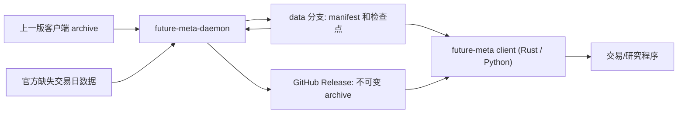

# future-meta

[](https://github.com/zynthium/future-meta/actions/workflows/update-fee-data.yml)
[](https://www.rust-lang.org/)
[](https://www.python.org/)
[](https://raw.githubusercontent.com/zynthium/future-meta/data/manifest.json)

中国期货手续费历史数据维护与本地 as-of 查询库（支持 Rust 与 Python 客户端）。

提交、验证和发版遵循 [发布规则](docs/releasing.md)：普通提交运行 CI，纯文档不升级 SDK；明确推送 SDK 版本标签后由 Actions 验证并创建 Release，数据日更独立运行。

`future-meta` 从交易所官方数据维护手续费、保证金和规格变更历史。日更直接以既有客户端 archive 为基线；客户端读取独立 `data` 分支的 manifest，再下载不可变 Release 附件，在本地完成高性能 as-of 查询。SQLite 和原始证据只供本地诊断。

> [!IMPORTANT]
> SDK 与数据独立发布：包含大商所月均价合约的数据包需要 SDK v0.7.0 或更新版本；升级一次后，每日数据更新不要求升级 SDK。下载使用新的 [manifest URL](https://raw.githubusercontent.com/zynthium/future-meta/data/manifest.json)。最后尝试、成功时间与完整核验日期见 [更新状态](https://raw.githubusercontent.com/zynthium/future-meta/data/update-state.json)，不以 archive 的生成时间代替检查进度。

## 功能特性

- 手续费和规格只属于具体期货合约，例如 `SHFE.cu2607`、`CZCE.SR903`。
- 支持大商所 `DCE.l2611F`、`DCE.pp2611F`、`DCE.v2611F` 月均价合约；完整保留 `F` 后缀及独立费率、规格和生命周期。TqSdk 品种标识仍为 `DCE.l`、`DCE.pp`、`DCE.v`，品种查询包含该品种的普通与月均价合约。
- 支持具体合约、品种下具体合约的 as-of 手续费查询；`KQ.m@...`、`KQ.i@...` 不返回手续费或规格。
- 提供可按历史时间查询的合约乘数、最小变动价位，以及派生的每手每跳价值。
- 支持预解析 `ContractHandle`、`PreparedFee` 和跨日 day-fixed cursor 表，适合高频回测热路径。
- 客户端 archive 使用 `bincode` + `zstd` 压缩，并带 SHA-256 校验。
- 日更对业务字段比较，仅在变化时追加历史版本；无变化保持 archive 原字节。独立保留日内开仓费与未知值。
- 官方日更采集六所逐日参数及必要 CBI，复用已批准规格规则后按需生成客户端 artifact；规格文档与目录另行手动审阅，日度检查点不代表规格重新核验。工作日在夜盘前窗口内多次候选唤醒，早晨仅节后首个早晨准入，同一时段最多采集一轮；本地官方日历门禁跳过周末、休市和节前无夜盘。只读健康检查报告漏更，GitHub 调度延迟仍可能发生。线上状态须以实际运行和发布读回为准。

## 架构



工作区包含三个 crate：

| Crate | 作用 |
| --- | --- |
| `future-meta` | 公开模型、archive 编解码、下载缓存、TqSdk symbol 解析和 as-of 查询 API |
| `future-meta-daemon` | archive 增量历史维护，以及本地 SQLite 重建、证据审阅与导出工具 |
| `future-meta-py` | 基于 `PyO3 + maturin` 的独立 Python C-Extension 绑定（`future_meta`），保持核心 Rust crate 零 Python 依赖 |

## 快速开始

运行在线 smoke test，通过 data 分支 manifest 下载 Release 附件并查询 `SHFE.cu2607`：

```bash
cargo run -p future-meta --features download --example online_smoke SHFE.cu2607 2026-06-08T10:48:06Z
```

在自己的 Rust 程序中使用：

```toml
[dependencies]
future-meta = { git = "https://github.com/zynthium/future-meta", features = ["download"] }
tokio = { version = "1", features = ["macros", "rt-multi-thread"] }
time = "0.3"
```

```rust
use future_meta::{DownloadConfig, load_or_fetch};

#[tokio::main]
async fn main() -> Result<(), Box<dyn std::error::Error>> {
    let meta = load_or_fetch(DownloadConfig::default()).await?;

    let contract = meta.contract("SHFE.cu2607")?;
    println!(
        "lot_size={}, tick_size={}, tick_value={}",
        contract.lot_size,
        contract.tick_size,
        contract.tick_value()
    );

    let historical_spec = meta.contract_spec_asof(
        "DCE.p2605",
        "2026-04-09T10:00:00+08:00",
    )?;
    println!("historical tick_size={}", historical_spec.tick_size);

    let fee = meta.contract_fee_asof("SHFE.cu2607", "2026-06-08T10:48:06Z")?;
    println!("open={:?}, close_today={:?}", fee.open_fee, fee.close_today_fee);

    Ok(())
}
```

默认 manifest 地址是：

```text
https://raw.githubusercontent.com/zynthium/future-meta/data/manifest.json
```

可用 `FUTURE_META_CACHE_DIR` 覆盖客户端 artifact 缓存目录。

SDK v0.8.0 新增 `DownloadClient`。长驻进程需要定期检查更新时，保留该实例，避免每次检查都解压和重建索引。在 async 函数中使用：

```rust
use future_meta::{DownloadClient, DownloadConfig};

let mut client = DownloadClient::load(DownloadConfig::default()).await?;
let mut handle = client.meta().resolve_contract("SHFE.cu2607")?;

// 在后续需要检查更新时调用，不放入每次行情查询的路径。
if client.refresh().await? {
    handle = client.meta().resolve_contract("SHFE.cu2607")?;
}
let contract = client.meta().contract_for_handle(handle)?;
```

`refresh()` 在 HTTP 304 或 archive SHA 未变时返回 `false`，复用当前 `FutureMeta`、索引和句柄，不读磁盘缓存；SHA 变化时校验并加载新包后返回 `true`，此时需重新解析句柄及构建预计算表。失败会返回错误并保留当前实例和已有缓存。

该客户端复用 HTTP 连接池及内存中的 ETag，刷新频率由调用方控制，每次刷新仍会发出一次 manifest 检查请求。`load_or_fetch` 继续用于一次性加载。

### 在 Python 中使用

可从 GitHub Release 下载对应平台的 `.whl` 附件安装，或在仓库根目录通过 `maturin` / `uv` 本地安装：

```bash
pip install maturin
maturin develop --release
```

Python 端提供同步阻塞接口（内部托管 Tokio Runtime 并释放 GIL）：

```python
import future_meta

# 一次性加载或长驻客户端定期刷新
client = future_meta.DownloadClient.load()
meta = client.meta()

contract = meta.contract("SHFE.cu2607")
print(contract.lot_size, contract.tick_size, contract.tick_value())

spec = meta.contract_spec_asof("DCE.p2605", "2026-04-09T10:00:00+08:00")
fee = meta.contract_fee_asof("SHFE.cu2607", "2026-06-08T10:48:06Z")
print(spec.tick_size, fee.open_fee.to_dict(), fee.close_today_fee.to_dict())

# 后续检查是否有新数据包
if client.refresh():
    meta = client.meta()
```

`Manifest.generated_at` 与 `data_version` 表示 artifact 构建时间；
`history_end` 与 `fee_effective_from` 表示最后一条已批准手续费的生效时间。两者不同，
不应把构建时间当作费率最新时间。

## 查询 API

`FutureMeta` 保留通用查询入口；高频回测优先使用跨日预编译 cursor 表：

| API | 说明 |
| --- | --- |
| `contract(symbol)` | O(1) 查询合约乘数、最小变动价位等静态规格元数据 |
| `contract_for_handle(handle)` | 使用已解析的 `ContractHandle` 查询合约规格，适合热路径；`tick_value()` 返回每手每跳价值 |
| `contract_spec_asof(symbol, at)` | 查询 RFC3339 时间点有效的合约乘数、最小变动价位和每手每跳价值 |
| `contract_spec_at/on(...)` | 使用预解析时间或交易日查询历史合约规格 |
| `contract_spec_for_handle_at/on(...)` | 使用 `ContractHandle` 查询历史合约规格，避免重复解析 symbol |
| `contract_fee_asof(symbol, at)` | 查询具体期货合约在某个 RFC3339 时间点所属交易所本地日期的手续费 |
| `contract_fee_at(symbol, at)` | 使用已解析的 `OffsetDateTime` 查询，内部按交易所本地日期选择日级手续费 |
| `contract_fee_on(symbol, trading_date)` | 使用交易所本地 `Date` 查询，适合手续费盘中不变的场景 |
| `resolve_contract(symbol)` | 将合约 symbol 预解析为 `ContractHandle` |
| `prepare_fee_cursors(handles, trading_date, start_unix_nanos)` | 构建跨日 day-fixed cursor 表，是 tick 回测推荐入口 |
| `for_trading_day(trading_date)` | 构建单日交易快照，适合已经按日切分的高级用法 |
| `TradingDayMeta::prepare_fee(handle)` | 单日内将手续费编译为紧凑数值结构 |
| `TradingDayMeta::prepare_fee_book(handles)` | 单日内按 caller slot 顺序构建连续 `PreparedFee` 表 |
| `TradingDayMeta::prepare_fee_cursors(handles, start_unix_nanos)` | 单日内按 caller slot 顺序构建可跨日推进的 cursor 表 |
| `underlying_fees_asof(underlying_symbol, at)` | 查询某个品种在该时间点不是 `NotTrading` 的具体合约手续费列表；`Unknown` 保留 |

tick 回测通常跨多日。推荐先解析合约，再构建跨日 cursor 表：

```rust
use future_meta::{DownloadConfig, load_or_fetch};

#[tokio::main]
async fn main() -> Result<(), Box<dyn std::error::Error>> {
    let meta = load_or_fetch(DownloadConfig::default()).await?;
    let handle = meta.resolve_contract("SHFE.cu2607")?;
    let mut fees = meta.prepare_fee_cursors(
        [handle],
        first_tick.trading_date,
        first_tick.unix_nanos,
    )?;

    for tick in ticks {
        if tick.unix_nanos >= fees.next_change_unix_nanos() {
            fees.advance_to(tick.trading_date, tick.unix_nanos)?;
        }

        let fee = fees.current(tick.fee_slot)?;
        let amount = fee.open_amount(tick.price, tick.lots);
        println!("open fee amount={amount}");
    }

    Ok(())
}
```

多合约混合 tick 时，预先把 symbol 映射成 slot，循环内只用整数索引。低频路径可直接用便捷方法：

```rust
let mut fees = meta.prepare_fee_cursors(handles, first_tick.trading_date, first_tick.unix_nanos)?;

for tick in ticks {
    let fee = fees.advance_and_get(tick.trading_date, tick.fee_slot, tick.unix_nanos)?;
    pnl -= fee.close_today_amount(tick.price, tick.lots);
}
```

`PreparedFeeCursors` 内部只在交易日边界慢路径重建；正常 tick 路径是一
次 `i64` 比较和一次 slot 读取。交易日快照和 cursor 都只使用加载 archive 后派生的
内存索引，不会把交易日等派生字段写入 `latest.fmeta.zst`。

手续费字段保留源站规则语义：

- `open_fee`
- `close_yesterday_fee`
- `close_today_fee`
- `intraday_open_fee`（未知时为 `None`）
- `buy_margin_rate`
- `sell_margin_rate`
- `source_updated_at`
- `valid_from` / `valid_to`

> [!NOTE]
> `valid_from` 为闭区间起点，`valid_to` 为开区间终点。手续费按交易所本地日期生效，不在日内盘中切换；时间戳查询会先映射到交易所本地日期。`valid_to = None` 表示当前仍有效。

## 数据来源与边界

当前维护链路只接受交易所官方原件及其可追溯采集输出：

- 初始历史使用六所官方参数、生命周期与合约规格从零重建，不读取旧 SQLite 补值。步骤见 [官方数据重建说明](docs/official-rebuild.md)。
- 日常增量恢复同一截止日的维护库和官方元数据 bootstrap，仅采集其后缺失的官方交易日；校验短区间重建库后，由 `update-collected` 合并到新副本。完整流程见 [部署说明](docs/deployment.md#github-定时更新)。
- 新上市 symbol 必须有生命周期和规格依据；缺少参数或元数据时失败并保留诊断，不以旧合约、品种费率或零值补齐。首条官方观测前的空档继续保留为未知。
- 公告扫描只做补充发现和审计，待复核队列独立保留；人工历史补充仍按 [官方历史证据流程](docs/official-evidence.md) 暂存、复核并导入审阅副本。
- archive schema 4 使用共享字典、按合约批量变更和日期引用增量编码，完整保留规格历史、多空保证金和独立日内开仓费。0.5.0 客户端兼容 schema 1/2/3，加载后仍使用原查询模型；详见 [格式迁移说明](docs/archive-format.md)。

旧第三方抓取、候选交叉核验及其更新命令已移除。历史来源记录和审阅材料仍保留，但不作为日更输入，也不追溯改称官方证据。

项目只持久化手续费查询需要的基础字段。不会把源站展示用派生字段写入 client archive，例如价格、涨跌停、每手保证金、每跳盈亏、手续费折算金额等。

## 本地维护数据

检查已有 seed：

```bash
cargo run -p future-meta-daemon -- inspect --db data/future-meta.sqlite
```

生成 2020 年以来五字段历史覆盖报告：

```bash
cargo run -p future-meta-daemon -- audit-coverage \
  --db data/future-meta.sqlite \
  --from 2020-01-01 \
  --through 2026-08-24 \
  --out /tmp/future-meta-coverage.json \
  --strict
```

`--strict` 要求范围内每个合约都有官方上市日、到期日，以及来源标记为
`official` 的连续手续费和合约规格区间。任一缺口都会在写出 JSON 报告后返回失败。
不带 `--strict` 时只生成报告，适合补证据期间查看剩余缺口。

暂存人工复核过的交易所历史材料：

```bash
cargo run -p future-meta-daemon -- stage-official \
  --db data/official-evidence.sqlite \
  --input path/to/adjustments.json
```

将证据库中已复核、已配对的公告与参数文件物化到审阅副本：

```bash
cargo run -p future-meta-daemon -- import-official-history \
  --db path/to/review-copy.sqlite \
  --evidence-db data/official-evidence.sqlite \
  --exchange CFFEX \
  --snapshot-dir data/official-evidence \
  --from 2020-01-01 \
  --through 2026-08-24
```

导入器只读取 `verified` 记录，逐份验证保留文件的 SHA-256，并要求公告与收费表或
结算参数配对。部分调整只能继承同一具体合约此前已导入的完整官方三腿参数；缺少
完整前序时硬失败。也可重复传入 `--input reviewed.json`，导入未写入证据库的已复核
JSON。

官方生命周期与合约规格使用独立 TSV 导入，不能复用只含手续费的页面：

```bash
cargo run -p future-meta-daemon -- import-official-metadata \
  --db path/to/review-copy.sqlite \
  --manifest data/official-evidence/official-metadata.tsv \
  --snapshot-dir data/official-evidence
```

每行必须给出具体 `symbol`、上市日、到期日、连续规格区间、合约乘数、最小变动价位，
以及分别证明生命周期和规格的官方 URL 与 SHA-256。导入前验证全部保留文件；任一
合约的规格区间未从上市日连续覆盖到到期日时硬失败。

交易所每日参数表可在保留原始字节后，以较低证据等级直接建立完整三腿手续费历史。
例如 CZCE 导入只接受官方固定 URL、逐文件 SHA-256 和明确的绝对值/比例值单位，
并将版本记录为 `official_parameter`；已有 `paired_official` 版本不会被覆盖：

```bash
cargo run -p future-meta-daemon -- import-czce-parameters \
  --db path/to/review-copy.sqlite \
  --manifest data/official-evidence/czce-daily-params-20200101-20260818.tsv \
  --snapshot-dir data/official-evidence \
  --from 2020-01-01
```

该命令只应作用于审阅副本。它会先验证全部输入，再原子替换参数表覆盖期内相冲突的
第三方版本；相邻相同参数不会制造重复版本。手续费参数页不证明合约乘数或最小变动
价位，因此不会把派生规格冒充官方规格证据。

GFEX 每日结算参数也可按相同规则导入：

```bash
cargo run -p future-meta-daemon -- import-gfex-parameters \
  --db path/to/review-copy.sqlite \
  --manifest data/official-evidence/gfex-daily-settlement-20221222-20260818.tsv \
  --snapshot-dir data/official-evidence \
  --from 2022-12-22
```

导入器将 `openFee`、`offsetFee`、`shortOffsetFee` 分别映射为开仓、平昨、平今手续费；
`绝对值` 表示元/手，`比例值` 表示成交额万分比，零值保留为明确的零手续费。
`official_empty` 和 `pending` 清单项不构成覆盖证据，也不会被静默跳过后宣称完整。

INE 日参数的 `TRADEFEERATIO`、`TRADEFEEUNIT` 只证明一般手续费，不能单独证明平今。
导入时必须另给人工复核的官方平今规则：

```bash
cargo run -p future-meta-daemon -- import-ine-parameters \
  --db path/to/review-copy.sqlite \
  --manifest data/official-evidence/ine-dailydata-20200101-20260818.tsv \
  --close-today-rules data/official-evidence/ine-close-today-rules.tsv \
  --snapshot-dir data/official-evidence \
  --from 2020-01-01
```

规则可按品种或具体合约限定连续有效期，并明确 `same_as_general`、`Zero`、元/手或
成交额万分比。每个日参数观察都必须命中唯一的最高优先级规则；缺失、同级重叠、URL
或 SHA-256 不合法时，导入在写库前硬失败。成功版本同时保留日参数与平今规则两份
官方证据，并标记为 `paired_official`。

## 自动更新与部署

GitHub Actions 从现有 archive 和小检查点补齐缺失交易日；不下载 SQLite 或原件包。新数据先发布并校验 Release，再以一次提交同时更新 `data` 分支的 manifest 与检查点。无业务变化只更新状态，不重发 archive。缺少日度参数、元数据或请求失败均停止更新，不推进成功检查点；全量规则审阅独立手动执行。

固定索引：`https://raw.githubusercontent.com/zynthium/future-meta/data/manifest.json`。

SDK v0.7.0 默认使用此入口，也可显式配置：

```rust
let config = DownloadConfig {
    manifest_url: "https://raw.githubusercontent.com/zynthium/future-meta/data/manifest.json".into(),
    ..Default::default()
};
```

工作流为 `.github/workflows/update-fee-data.yml`，仅需内置 `GITHUB_TOKEN` 的 `contents: write`。无需 Pages。数据 Release 设置 `--latest=false`，SDK Latest 独立保留。

只验证当前公开数据，不访问交易所：

```bash
gh workflow run update-fee-data.yml --ref main -f republish_current=true
```

历史原件与 SQLite 在本地保留；从零重建和证据导入不属于日更链路。访问窗口、状态字段、迁移及诊断见 [部署说明](docs/deployment.md)。

## 开发

常用检查：

```bash
cargo fmt --all -- --check
cargo check --workspace --all-targets
cargo test --workspace
cargo test -p future-meta --features download
cargo clippy --workspace --all-targets --all-features -- -D warnings
cargo build -p future-meta-py
python3 -m unittest discover -s tests
```

性能 smoke test：

```bash
cargo run --release -p future-meta --example perf_smoke -- public/latest.fmeta.zst 1000000 100
```

高频回测热路径应使用 `FutureMeta::prepare_fee_cursors`。它统一处理日级固定手续费、跨日重建和多合约 slot；循环内通常只有一次 `i64` 时间比较和一次 `current()` 读取。

定向测试：

```bash
cargo test -p future-meta-daemon --test daemon_pipeline
cargo test -p future-meta --features download --test client_archive
```

生成目录默认不提交：

- `data/`
- `public/`
- `target/`
- `dist/`
- `.venv/`
- `.env`
- `.mcp.json`

## 常见问题

**为什么 client 只下载 artifact？**

采集和证据校验集中在维护端完成。客户端读取经过摘要校验的固定快照，才能在本地查询历史并固定回测输入，不依赖交易所网站的实时响应。

**新合约缺少参数或元数据怎么办？**

日更保留缺口报告并失败，待补充官方原件后重跑。不能从旧 SQLite、其他合约或品种默认值补齐，也不能删除缺失合约来制造完整覆盖。

**成功下载是否表示数据已更新到今天？**

不表示。应查看 `coverage.json` 的观测截止日与未知区间；manifest 构建时间、最后一次参数变化时间和实际观测截止日分别表示不同含义。
